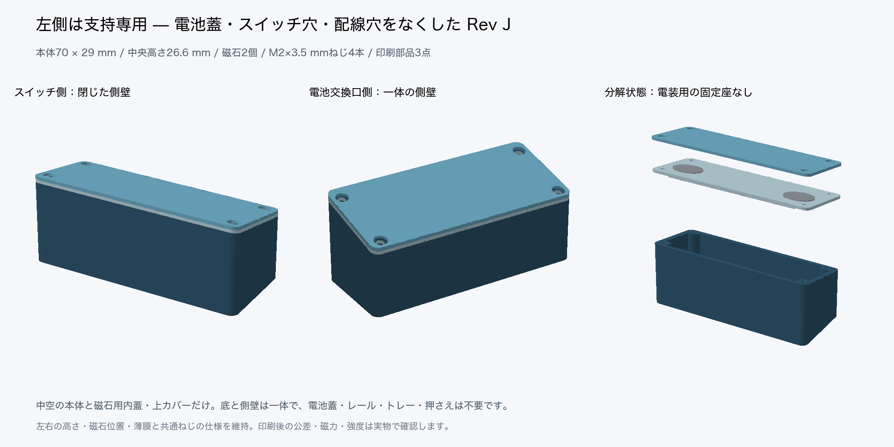
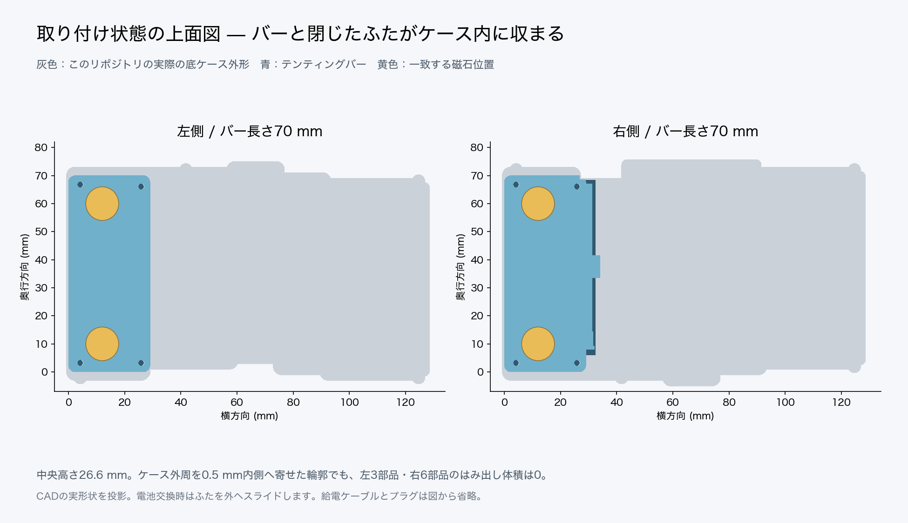
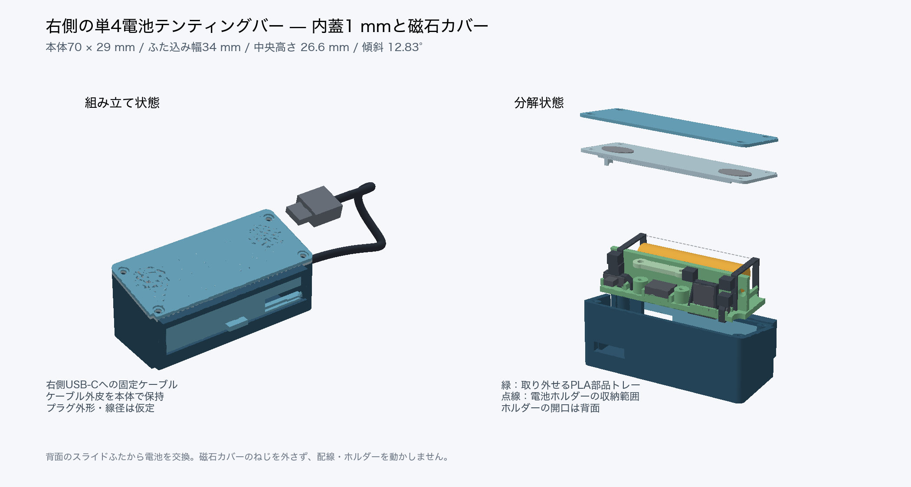
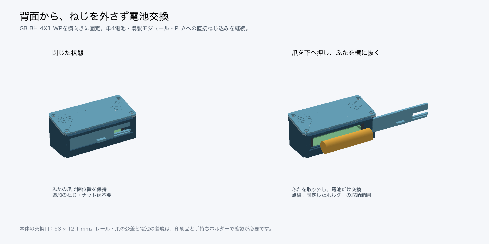
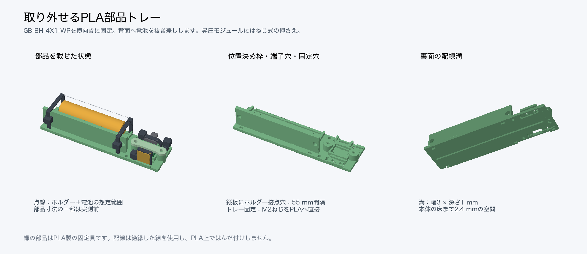
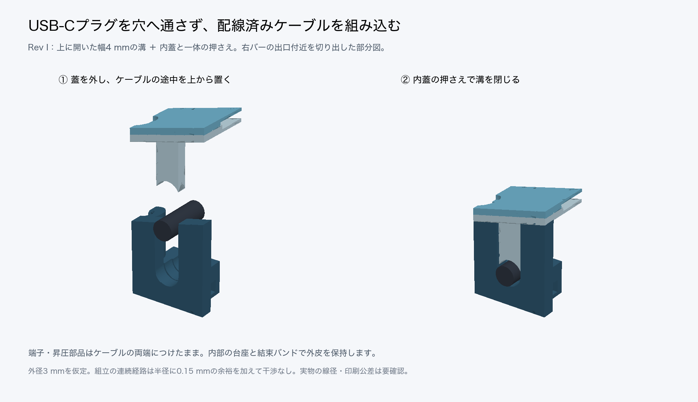
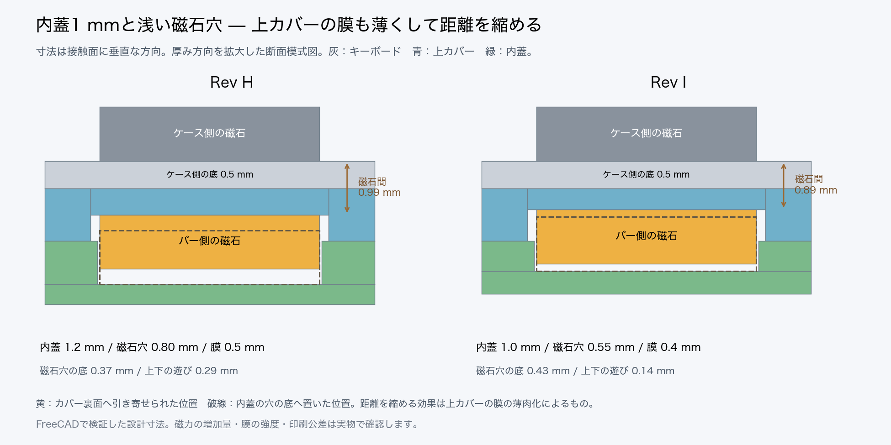

# komoro 単4電池テンティングバー — 試作 Rev J

このリポジトリの印刷用キーボードケースに合わせた、磁石着脱式のテンティングバー。
右バーに単4電池1本、GB-BH-4X1-WPと既製の昇圧モジュールを収め、右側XIAOのUSB-Cへ給電する。
左側は支持バーとして使う。左キーボードは受動基板で、USB-C端子を持たない。
左本体は電池交換口・スイッチ窓・配線穴のない一体の側壁とし、電装用の固定座・トレー・押さえ・電池蓋も設けない。
専用電源PCBは使わず、着脱式PLAトレーと絶縁配線で組む。部品と配線は[部品表](BATTERY-TENTING-BAR-PARTS.md)を参照。

Rev Eの100mmバーは別リポジトリの旧kb-1ケースを参照していた。
Rev Fは参照先を[現行ケース](generated/torabo-tsuki-om-keyboard-case.FCStd)へ修正し、
磁石位置・USB-C位置・キーボード輪郭を読み直している。
バーを70mmに短縮し、電池の前側へ電装品を並べることで、接触面高さ28mmを維持した。
取り付け状態で、外装・内蓋・カバー・トレー・押さえ・閉じた電池蓋の全体がケース輪郭内に収まるかを検証する。
元のキーボードケースは変更していない。

Rev Gは右バーのケーブル出口を上に開いた溝へ変更し、内蓋に一体の押さえを追加した。
プラグやはんだ付け済みの昇圧部品を穴へ通さず、ケーブルの途中を上から置いて組み立てる。
外寸・部品の収納位置・印刷部品数・ネジ数はRev Fから変えていない。

Rev Hは磁石穴のすり鉢状の斜面をなくし、内蓋を2.4mmから1.2mmへ薄くした。
上カバーは1.0mm、磁石真上の閉じた窓は0.5mmを維持する。
トラックボールケース固定用のM2×3.5mm低頭ねじ（FX-0235EB、頭径4mm・頭高さ0.3mm）を
カバー・トレー・モジュール押さえの全箇所で使えるようにした。
ねじ込み量はカバー約2.06mm、トレー2.10mm、モジュール押さえ2.00mm。
蓋の薄肉化に合わせて接触面高さも28mmから26.8mmへ下げ、収納とケース輪郭への収まりを再検証した。

Rev Iは内蓋を1.0mm、磁石穴の深さを0.55mmにして、厚さ1mmの磁石を組立位置で上カバー側へ0.45mm収める。
内蓋の穴の底は約0.43mmとなり、Rev Hの約0.37mmより厚くなる。
上カバー全体は1.0mmのまま、磁石真上の閉じた膜だけを0.4mmへ薄くした。
磁石がカバー裏面へ引き寄せられたときの磁石間距離は、ケース側の底0.5mmを含め、約0.99mmから約0.89mmとなる。
内蓋の薄肉化だけでは装着中の最小磁石間距離はほぼ変わらず、膜を薄くすることで距離を縮めている。
接触面高さは26.6mm、カバーねじのねじ込み量は約2.25mm。実際の磁力・保持力は未測定。

Rev Jは左を支持専用の3部品へ簡略化した。電池蓋と交換口、レール、解除爪、スイッチ窓、電装用の固定座を削除した。
給電ケーブル出口や配線用の穴も設けない。本体は上から開いた中空形状で、底と側壁を一体にする。
左の高さ・磁石位置・内蓋とカバー・M2×3.5mmねじ4本の仕様を維持し、右給電バーの形状はRev Iから変更していない。









## 生成物と印刷部品

[FreeCADモデル](generated/battery-tenting-bar/kb1-aaa-tenting-bars.FCStd)。
互換性のためファイル名は維持している。同名の旧版STLはRev Jへ置き換える。
左本体・内蓋・カバーはRev Jでそろえる。右給電バーはRev Iと同じ形状。旧版のM2×6mmねじは使わない。
ケーブル出口を備えた右本体と、一体の押さえを備えた右内蓋は組にして使う。

`generated/battery-tenting-bar/` に、左右の `housing`、`lid`、`cover` と、
右だけの `battery-door`、`tray`、`module-cage` のSTLとSTEPを保存する。
旧左用の `left-battery-door`、`left-tray`、`left-module-cage` は不要になったため出力しない。再生成時にも旧ファイルを削除する。
STLは印刷台に載せる向きへ変換し、最低点をZ=0に配置する。

- 右側：6点すべてを印刷する。
- 左側：`housing`、`lid`、`cover` の3点を印刷する。電池蓋・電装品は不要。
- 磁石穴の試し刷り用 `magnet-fit-coupon` と `magnet-fit-cover` は任意。
- 必須9点と試し刷り用の任意2点、計11点のSTLを出力する。

| 部品 | 左用STL | 右用STL |
|---|---|---|
| 本体 | [左](generated/battery-tenting-bar/left-housing.stl) | [右](generated/battery-tenting-bar/right-housing.stl) |
| 磁石用内蓋 | [左](generated/battery-tenting-bar/left-lid.stl) | [右](generated/battery-tenting-bar/right-lid.stl) |
| 磁石カバー | [左](generated/battery-tenting-bar/left-cover.stl) | [右](generated/battery-tenting-bar/right-cover.stl) |
| 電池蓋 | なし | [右](generated/battery-tenting-bar/right-battery-door.stl) |
| 部品トレー | なし | [右](generated/battery-tenting-bar/right-tray.stl) |
| モジュール押さえ | なし | [右](generated/battery-tenting-bar/right-module-cage.stl) |

## 寸法と保持構造

トレー・ホルダー・電装部品・電池交換機構の寸法は右側だけに適用する。

| 項目 | Rev J |
|---|---|
| バー外形 | 左70 × 29mm。右本体70 × 29mm、背面レール込み幅32.4mm、引き手込み幅34mm |
| 接触面の高さ | 磁石中心線で26.6mm。幅の中心と磁石中心線は異なる |
| 磁石中心線 | 外側の長辺から12mm。ケースの外側にはみ出さない位置 |
| 傾斜 | 約12.83°。現行底ケースの反対側の縁も机に接するよう算出 |
| 前後方向の傾き | 0°。現行ケースの内側磁石2点は前後一直線 |
| ケース奥行き | 左79.35mm、右80.75mm。最大外形の寸法であり、局所の段差・丸みも別途確認 |
| 壁 / 床 | 2.0 / 1.8mm |
| トレー主板 | 60.6 × 24.4 × 厚さ2mm。固定枠・端の逃げを除く |
| トレー下面 / 床との空間 | 机から4.2mm / 2.4mm |
| 配線溝 | 幅3 × 深さ1mm。溝の上に1mmの樹脂を残す |
| ホルダー | 横向きの収納範囲51 × 奥行15 × 高さ13mm。開口は背面の長い側面+V |
| ホルダーと内蓋の余裕 | 最小約1.21mm。ホルダー外形は未実測 |
| ホルダー固定座 | 接点55mm間隔・Ø3.4mmの穴を備えた縦板。端子は内側へ向く |
| 昇圧モジュール | 電池前側の配置。10 × 7.5 × 高さ3mmの収納範囲。はんだ込み高さは未実測 |
| モジュール固定座 | 下面1.6mm、押さえの下に0.4mmの余裕。縦板の下部に局所の逃げ |
| スイッチ / PTC / ダイオード | 8.8 × 3.9 × 3.5mm / 8.5 × 3.5 × 10mm / Ø2.6 × 長さ3.5mm。前側へ並べた想定範囲 |
| 内蓋 / 上カバー | 鉛直厚さ1.0 / 1.0mm、合計2.0mm。磁石真上は閉じた0.4mmの膜 |
| 磁石 | Ø12 × 厚さ1mm、2個/バー。左右とも中心間隔50mm |
| 磁石穴 | Ø12.25 × 深さ0.55mmの直穴。内蓋から磁石が0.45mm出るので、カバーを外して上から置き、指で押せる |
| 磁石穴の底 | 接触面に垂直な厚さ約0.43mm。すり鉢状の斜面はなし |
| 上カバーの磁石用凹み | 接触面に垂直な深さ約0.59mm。磁石との上下の遊び約0.14mm。引き寄せられた磁石が膜の裏面へ当たる |
| 磁石間距離 | 穴の底へ置いた位置：約1.03mm。カバー裏面へ引き寄せられた位置：約0.89mm。ケース側の底0.5mmを含む |
| カバー共締め | M2×3.5mm低頭4本/バー。FX-0235EBの頭径4mm・高さ0.3mmに合わせ、Ø4.2mm・深さ0.7mmの逃げ。ねじ込み約2.25mm |
| トレー締結 | 同じM2×3.5mm低頭2本/右バー。頭を0.6mm沈め、ねじ込み2.10mm |
| モジュール押さえ | 同じM2×3.5mm低頭2本/右バー。押さえ厚さ1.5mm、ねじ込み2.00mm |
| PLA直接ねじ込み | 対角2mm・対辺約1.73mmの正六角形下穴。インサート・六角ナット不要 |
| 電池交換口 | 幅53 × 高さ12.1mm。ホルダー・配線は固定したまま |
| スライド蓋 | 左へ60mm動かして外す。レール隙間0.3mm、一体の爪を下へ押して解除 |
| 解除爪 | 長さ16 × 面方向厚さ0.8 × 奥行1.9mm。解除変位0.9mm、押ししろ1.25mm。弾性・寿命は未評価 |
| 電池取り出し経路 | Ø10.5 × 長さ44.5mmの参照電池を背面へ22mm。半径+0.15mm、両端+1mmで干渉確認 |
| ケーブル出口 | 右側のみ。幅4mm・丸底の上開き溝。外径3mmを仮定。内蓋一体の押さえで上部を閉じ、外皮を台座と結束バンドで保持 |
| 出口の蓋側押さえ | 内蓋と一体で印刷。溝の両側に各0.2mm、ケーブルに半径方向0.5mmの想定隙間。追加ネジ不要 |

| 対応するケース磁石中心 | 現行キーボードCAD座標、mm | 中心間隔 |
|---|---|---|
| 左 | (117.5, 11)、(117.5, 61) | 50mm |
| 右 | (11, 61)、(11, 11) | 50mm |

左右のケースは元CADでは同じ原点へ配置され、モデル内では別グループで表示する。
磁石の極性はモデルから決定できないため、手持ちケース側と引き合う向きに組む。
磁石はカバーを外して浅い穴へ載せる。使用中はカバーが磁石を閉じ込める。
薄肉の磁石窓とケース側の床を挟む保持力は実物で確認する。

GB-BH-4X1-WPは90°横倒しにし、電池の長さ方向をバーの長手（キーボードの前後方向）へ合わせる。
右キーボードへ取り付けて上から見ると、ホルダーの開口は右方向、右半分のキー領域へ向かう側。
「背面」はこのスライドふたが付いたバーの長い側面を指す。

## 組立と電池交換

購入部品の寸法は一部未実測。ホルダー外形、ピン位置、モジュールと端子のはんだ込み高さ、
スイッチの端子、ケーブル径、プラグ外形を先に確認する。
固定ねじは[組立ガイド](../../build-guide.md)のトラックボールケース固定用M2×3.5mm低頭と同じ仕様。
[メーカー寸法表](https://wilco.jp/products/F/FX-EB.html#page3)のFX-0235EBを基準に、頭径4mm・頭高さ0.3mmで設計した。
普通のなべ頭や旧版の長いねじを代用しない。左右セットで12本、右8本・左4本を使用する。
磁石穴の底は約0.43mm、カバーのネジ頭の下は約0.28mm、磁石真上の膜は鉛直0.4mmなので、蓋と試し刷り部品は積層ピッチ0.15mm以下で試作し、薄肉が閉じていることを確認する。
膜と磁石の上下の遊び、磁石の実厚さを試し刷りで確認する。膜を介した保持力と膜のたわみ・強度は実物で評価する。

1. [磁石穴の試し刷り](generated/battery-tenting-bar/magnet-fit-coupon.stl)とカバーで磁石と薄肉を確認する。
2. 右側の電源部品に線をはんだ付けし、接合部・未接続線・ホルダー端子を絶縁する。
   PLA上ではんだ付けしない。ホルダーは手持ちの[GB-BH-4X1-WP](https://www.marutsu.co.jp/pc/i/595611/)を実測する。
3. 横向きホルダー、スイッチ、PTC、ダイオードをトレーへ固定する。
   ホルダー固定バンドは電池の両端より外へ配置する。背面側のバンド溝はトレー端へ開いている。
4. 昇圧モジュールを載せ、別体押さえをM2×3.5低頭ねじ2本で固定する。
5. 配線を裏面へ収め、トレーをM2×3.5低頭ねじ2本で固定する。
   内蓋・上カバーを外した状態でケーブルの途中を出口の溝へ上から置く。
   USB-Cプラグを出口へ通す必要はなく、配線をはんだ付けし直す必要もない。
   ケーブル外皮を台座へ結束し、引っ張りや電池交換の力が端子へ伝わらないようにする。
6. 磁石の極性を合わせて内蓋へ置き、上カバーと一緒にM2×3.5低頭4本で共締めする。
   右内蓋の一体の押さえを出口の溝へ入れ、線を挟まないことを確認する。
   左支持バーにも磁石と蓋を同様に組む。PLAねじ山を潰さないよう締める。
7. 右側の背面蓋をレールへ入れ、爪が閉位置を保持することを確認する。

右側の電池交換では昇圧をOFFにする。爪を下へ押して引き手から蓋を横へスライドし、
電池をホルダーのばね側へ寄せて背面へ抜く。
新品を正しい極性で入れ、蓋を閉位置へ戻す。
磁石カバーのねじ、トレー、ホルダー、配線を動かさずに交換できる想定。
スライドには60mmの空間が必要で、手が入りにくければバーを磁石から外して交換する。

右側USB-Cの位置は、ケース生成スクリプトと同じPCB解析からXIAOの位置・回転を読み取っている。
ソケット・プラグは位置と収納範囲の概略モデルで、実物の挿抜やCC抵抗を確認する。
ケーブルはケース外へ回して端子へ接続するため、上面図の外形検証は印刷部品と閉じた蓋を対象とする。
左側には給電ケーブル出口・スイッチ窓・電池交換口を作らない。

## FreeCADでの確認・再生成

組み立て形状、収納部品、ケース、電池交換経路は別オブジェクト。
右バーを初期表示し、左は非表示。左右のグループを切り替えて確認する。
`…KeyboardFootprint` は実際の底ケースの外周を上面へ投影した輪郭。
`RightBatteryDoorOpen`、`RightBatteryExchangeSweep` は右側の交換時の位置・移動経路。
`RightCableInstallSweep` は蓋とケーブル固定バンドを外した状態の、出口での鉛直組み込み経路。
`RightCableOutletClosure` は内蓋の一体の押さえを確認するための参照コピーで、独立した印刷部品ではない。
`…Magnet1/2` は穴の底に置いた位置、`…MagnetAttracted1/2` はカバー裏面へ引き寄せられた位置。
2つの位置での磁石間距離を区別して記録する。後者は保持力の数値予測ではない。
`…Exploded` は分解状態のコピーで通常は非表示。
左の電装参照形状・トレー・押さえ・電池蓋は削除済み。`LeftBar` の印刷部品は3点、ねじ参照は4本だけ。

形状は[生成スクリプト](generate-battery-tenting-bar.py)の定数から生成する。
FreeCADの寸法プロパティは記録用で、スケッチ／Padの履歴は持たない。
寸法を変える場合はスクリプトを変更して再生成する。

FreeCADのPythonコンソールから実行する例：

```python
from pathlib import Path
script = Path('/Users/beryu/ghq/github.com/beryu/torabo-tsuki-om/3d-models/FreeCAD/generate-battery-tenting-bar.py')
exec(compile(script.read_text(), str(script), 'exec'), {'__name__': '__main__', '__file__': str(script)})
```

既定の入力はこのリポジトリの `generated/torabo-tsuki-om-keyboard-case.FCStd`。
`KB1_CASE_FILE` は同じオブジェクト構成のケースへの差し替えに使う。
旧 `BottomShell` 形式の別リポジトリのケースは入力に使わない。
`TENTING_HOLDER_HEIGHT_MM`（既定15）は横向きホルダーの奥行、
`TENTING_CABLE_DIAMETER_MM`（既定3）はケーブル径を指定する。
USB-C位置は右側PCBファイルにも依存する。
プレビューは `render-battery-tenting-bar.py` で実際のCADの三角形データから描画する。

## 検証と未確認事項

FreeCAD 1.1.0で左3点・右6点の印刷部品が有効な単一ソリッドであること、試し刷り用を含む11点のSTLが閉じたメッシュで
印刷台Z=0へ配置されることを確認した。保存したFCStdとSTLも読み直した。
記録は `validation.json` と `saved-files-validation.json`。

外形の検証は最大寸法の比較だけでなく、現行底ケースの実際の外周線に対するブーリアン差分で行う。
外周線は底のケーブル溝より上、Z=1.45mmの断面から読み取り、穴を除いた外周を上面へ投影する。
右ケースの角に合わせ、本体・内蓋・カバーの端をこの輪郭へ切り詰め、内側の角も丸めている。
印刷部品全体とネジが外周線内に入り、さらに元の外周を0.5mm内側へ寄せた輪郭でも収まることを確認した。
交換中の蓋とケーブル／プラグはその外形制約の対象外。

部品、ねじ芯・頭、固定バンド、配線収納範囲、ケーブル、上下ケースとの干渉を確認した。
右側の蓋のスライド全経路、電池の背面取り出し全経路、Ø10mmの指先接近範囲も確認した。
左側は、4本の盲ねじ下穴を除いた閉じた底・側壁の全形状が本体に残っており、余分な開口やレールがないことを確認した。
閉じた爪の引っかかり、磁石の閉じた窓と上方への抜け止めも確認した。
引き寄せられた位置の磁石も内蓋・上カバーへ食い込まず、そこから上へ0.01mm移動すると膜が止めることを確認した。
右の出口では線径3mmへ半径方向0.15mmを加え、上方30mmから座面までの連続組み込み経路が
本体・トレー・押さえ・電池蓋・電装品に干渉しないことを確認した。
内蓋の出口押さえも本体・ケーブルへ干渉しない。配線済みプラグを小穴へ通す工程をなくした。
ケーブル全体の曲げを伴う組み付け操作は、実物で確認する。
ねじ芯はØ1.5mmの参照円筒で、ねじ山の強度検証ではない。
全箇所で3.5mmねじ芯・Ø4×0.3mmの頭が干渉せず、2.00mm以上のねじ込みが残ることを確認した。
磁石穴の底とネジ頭下の薄肉は寸法を確認しているが、締め付け強度とたわみは実物で確認する。
解除爪の移動形状も概略の逃げ確認で、弾性解析ではない。

ホルダーやプラグは概略形状。全配線・はんだ・結束バンドの留め具を精密にはモデル化していない。
実物の組立、公差、PLAねじ山と解除爪の保持力・寿命、発熱、磁力、電池交換、ケーブル曲げ、
左右を接続したキーボード全体の給電動作は未評価。実機評価に使う試作設計。
